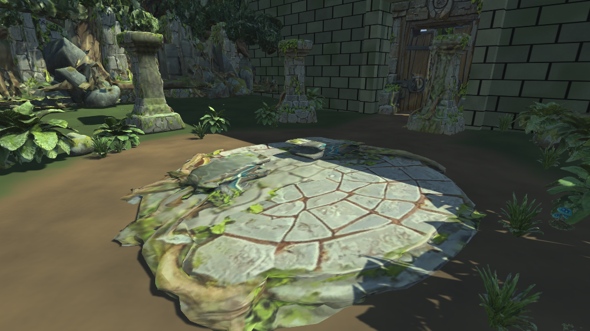

# 구조물 접지와 숲 진입 제한

- 7개 방의 바위·기둥·유적·제단·받침 등 117개 배치물의 실제 메시 하단을 바닥 충돌 메시와 비교해 내렸습니다. 평균 약 8.3cm, 최대 약 19.9cm 이동했습니다. 접지 기준점을 지면에 5cm 묻었으며 이미 충분히 묻힌 물체는 올리지 않았습니다.
- 높이 있는 발판은 받침과 함께 내려 기존 높낮이와 연결을 유지했습니다. 장식용 나무와 풀은 재배치하지 않았습니다.
- 방마다 `ForestSideLimits` 아래 좌우 BoxCollider를 추가했습니다. 일반 방은 Z ±12m, 보스 방은 ±15m에서 진입을 차단합니다. 24m 높이여서 점프나 높은 구조물을 통한 우회를 막으며, 경계에는 렌더러가 없어 숲을 계속 볼 수 있습니다.
- 경계는 방의 바닥 범위보다 양끝 0.5m씩 길게 만들어 방 연결 지점의 틈을 방지했습니다. 방 씬과 함께 로드/해제됩니다.
- 낮아진 구조물에 맞춰 모든 방을 연 상태에서 NavMesh를 다시 구웠습니다. 새 데이터는 `Assets/Scenes/ForestRooms/ForestGroundedNavigation.asset`이며, 좌우 경계에는 NavMeshObstacle carving도 적용했습니다. 이후 수동으로 NavMesh를 다시 구울 때도 7개 방을 모두 열어야 합니다.

## 검증

- 조정 대상 접지 기준점의 양수 간격: 0개.
- 양옆 점프·대시 실제 이동 검사 2회 통과.
- 7개 방 좌우 경계의 높이/길이 방향 레이 검사 126회 통과.
- 바닥 표본 768개와 적 17마리의 NavMesh 연결 통과.
- 1~7번 방 전환, 최대 두 방 유지, 뒤쪽 차폐, 방별 복귀 위치, 최종 클리어 통과.
- 상세 기록: `GroundingChanges.json`, `PlayModeVerification.json`.
- 기존 VARCO 패키지 경로 오류 외에 새 실행 오류는 확인되지 않았습니다.

변경 전 공통 씬과 방 씬은 `Before/`에 보관했습니다. Unity는 편집 모드의 `3D.unity`로 돌려놓았습니다.
