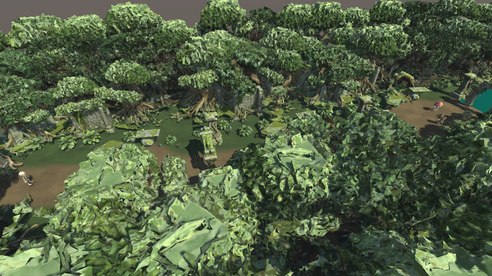

# 3D 숲 에셋 경량화 결과

2026-09-17 · 대상: Assets/Scenes/3D.unity / Stage1_3D_Forest

## 결과

- 미배치 모델 5종과 해당 meta 삭제: 04 LogBridge, 07 GrassTerrain, 12 HangingVines, 17 StoneFloor, 21 Stairs. Assets 내 씬·프리팹·재질·asset 참조가 없음을 확인했습니다. 공유 텍스처와 재질은 유지합니다.
- 사용 모델 19종과 숲 바닥: 삼각형 252,924 → 141,508개, 44.1% 감소. 보스 제단은 형태 기준을 통과하지 못해 원본 유지.
- 571개 배치 메시 합계: 7,967,421 → 5,497,021개, 31.0% 감소. 이 값은 배치 총량이며 카메라의 실제 프레임별 렌더링 수나 FPS 측정값은 아닙니다.

## 모델별 삼각형

| 모델 | 원본 | 적용 | 감소 |
|---|---:|---:|---:|
| F3D_01_AncientTree | 16000 | 15424 | 3.6% |
| F3D_02_BentTree | 16000 | 15423 | 3.6% |
| F3D_03_BranchedTree | 16000 | 15322 | 4.2% |
| F3D_05_RootBridge | 15772 | 1891 | 88.0% |
| F3D_06_RootPlatforms | 16000 | 14511 | 9.3% |
| F3D_08_StonePlatform | 15999 | 4799 | 70.0% |
| F3D_09_LargeRock | 12250 | 1470 | 88.0% |
| F3D_10_SmallRock | 6761 | 676 | 90.0% |
| F3D_11_Bush | 16000 | 12801 | 20.0% |
| F3D_13_Grass | 16000 | 9600 | 40.0% |
| F3D_14_Fern | 16000 | 15215 | 4.9% |
| F3D_15_Mushrooms | 15999 | 5598 | 65.0% |
| F3D_16_Altar | 15999 | 2398 | 85.0% |
| F3D_18_TowerWall | 5352 | 1872 | 65.0% |
| F3D_19_Pillar | 3744 | 1496 | 60.0% |
| F3D_20_Arch | 5808 | 2904 | 50.0% |
| F3D_22_BrokenPlatform | 4749 | 1663 | 65.0% |
| F3D_23_Door | 7722 | 4634 | 40.0% |
| F3D_24_BossDais | 12337 | 12337 | 0.0% |
| F3D_ForestFloor | 18432 | 1474 | 92.0% |

## 외형 보호와 확인

- 원본과 후보 표면 사이의 양방향 거리 검사: 면을 이루는 정점 및 삼각형 중심을 표본으로 사용. 렌더링되지 않는 고립 정점은 제외.
- 얇은 식물: 모델 대각선 대비 95백분위 오차 0.15%, 최대 0.6% 이내. 일반 소품: 0.25%, 최대 0.8% 이내. 바닥: 95백분위 2cm, 최대 5cm 이내. 연속 표면 전체에 대한 수학적 보장은 아닙니다.
- 네 면 이하로 구성된 작은 독립 조각은 원형을 보존. UV와 재질 슬롯을 유지하고, 후보 중 기준을 통과한 가장 낮은 삼각형 수를 채택. 완전 동일한 외형이나 절대적인 최저 폴리곤 수를 의미하지 않습니다.
- Unity에서 모델별 앞뒤 2방향 이미지 및 같은 카메라 위치의 숲 장면 전후 비교. FBX 단위 변환도 수정 후 다시 확인.
- GUID와 메시 fileID 20종 모두 유지. UV 유효성, 서브메시 수, 프리팹 단위 스케일, 기대 삼각형 수 검증 통과.
- 배치 메시 누락 0, MeshCollider 메시 누락 0, 재질/셰이더 누락 0, 스크립트 누락 0. 게임 플레이/FPS 벤치마크는 수행하지 않았습니다.
- 기존 VARCO 패키지 로컬 경로 오류가 콘솔에 남아 있습니다. 이번 작업 범위에서는 변경하지 않았습니다.

## 전후 화면

[모델별 변경 전](Previews/assets_before.png) · [모델별 변경 후](Previews/assets_after.png)

## 백업 및 재현

- Originals/Models: 삭제 5종을 포함한 원본 FBX 25종과 meta.
- Originals/Models.json: 변경 전 목록. Originals/3D.unity.txt: 작업 시작 시 디스크의 씬 백업.
- 복구는 필요한 원본 FBX와 해당 meta를 Assets/Art/3DStage1/Models에 복사한 뒤 Unity에서 재임포트합니다. 삭제 모델까지 복구하려면 원래 Models.json도 함께 복구합니다.
- optimize.py: Blender 4.3용 후보 생성 도구. 원본을 읽고 Candidates에만 출력합니다. UV를 유지한 감축, 형상 오차 검사를 수행합니다.
- reduction_metrics.json: 후보별 검사 기록. baseline_assets.json / baseline_instances.json / after_validation.json: Unity 검증 기록.
- 씬 파일, 배치, 게임플레이 스크립트는 수정하지 않았습니다. Editor에 있던 별도의 미저장 편집도 저장하거나 되돌리지 않았습니다.
