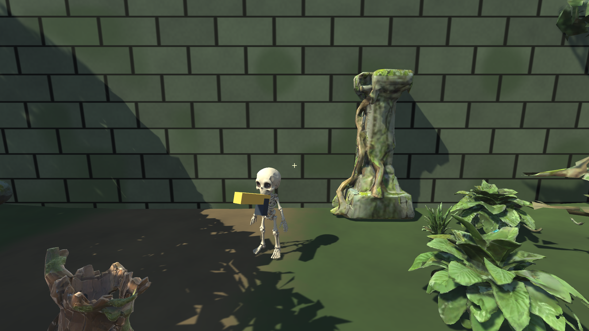

# 숲 7개 방 Additive 스트리밍

## 실행과 편집

- `Assets/Scenes/3D.unity`에서 실행합니다. 플레이어, 카메라, HUD, 스킬 UI, 진행 관리자와 기존 NavMesh 데이터는 이 공통 씬에 있습니다.
- 맵은 `Assets/Scenes/ForestRooms/Forest_Room_01.unity`부터 `Forest_Room_07.unity`까지 분할했습니다. 방 씬만 단독으로 실행하는 방식은 지원하지 않습니다.
- 방에는 장식, 잘라낸 바닥/충돌 메시, 적, 전진 문, 뒤쪽 차폐벽, 해당 회복 지점 및 출구가 있습니다. 수정할 방을 공통 씬과 Additive로 열어 편집할 수 있습니다. 실행 전에는 첫 두 방만 열거나 공통 씬만 열어 주세요.
- Build Settings에 공통 씬과 7개 방 씬을 등록했습니다. 첫 두 방은 편집 화면에도 열어 두었습니다.

## 전환 규칙

1. 시작 시 1·2번 방을 준비합니다. 바닥 준비가 끝날 때까지 이동을 잠급니다.
2. 다음 방의 적은 미리 활성화하지 않습니다. 현재 방의 적을 모두 쓰러뜨리고 다음 씬이 준비되어야 전진 문이 열립니다.
3. 문에서 3m 이상 다음 방으로 진입하면 뒤쪽 불투명 차폐벽을 닫고 카메라가 벽 뒤로 넘어가지 않도록 제한합니다.
4. 현재 방 번호와 낙하 시 복귀 위치를 갱신하고 새 방의 적을 활성화합니다. 이전 전투의 발사체와 위험 장판도 정리합니다.
5. 이전 씬을 완전히 해제한 다음 새 다음 씬을 비동기 로드합니다. 전환 중에도 세 방을 동시에 로드하지 않습니다.
6. 마지막은 7번 방만 유지합니다. 보스를 처치하고 초록 출구에 도달하면 기존 클리어 처리가 실행됩니다. F5는 공통 씬부터 다시 시작합니다.

이 구조는 일방향 진행입니다. 이미 통과한 방의 적, 회복 지점 등은 되돌아가 사용할 수 없습니다. 다음 씬 로딩에 실패하면 전진 문을 잠근 채 재시작 안내를 표시합니다.

## 성능 범위

- 적과 문을 포함한 7개 방 메시 전체 합계: 5,526,965 삼각형.
- 두 방 합계: 1,308,340~1,904,178 삼각형. 전체를 모두 유지할 때보다 약 66~76% 적습니다.
- 이 값은 비활성 적/문까지 포함한 배치 메시 합계이며 실제 프레임별 렌더링 수나 FPS 측정값은 아닙니다. 공통 플레이어/UI는 별도입니다.
- 장식 모델을 중복 복제하지 않고 방별로 나누었습니다. 바닥은 경계 평면에서 실제로 잘라 7개 메시로 저장해 큰 원본 바닥이 계속 렌더링되지 않게 했습니다.
- 기존의 구운 NavMesh 데이터는 공통 씬에 유지합니다. 새 차폐벽에는 NavMeshObstacle carving을 적용합니다. 메시/적/충돌체는 방별로 해제되지만 공용 모델·텍스처와 NavMesh 데이터가 메모리에서 모두 해제되는 것은 아닙니다.
- 비동기 로딩의 활성화 단계에서 짧은 끊김이 생길 가능성은 남습니다. 빌드 환경의 FPS/프레임 시간 측정은 별도로 필요합니다.

## 실제 플레이 검증

`PlayModeVerification.json`에 결과를 보관했습니다.

- 1→7번 순차 전환 및 모든 전투 완료: 통과.
- 상주 방 최대 2개, 마지막 방 1개: 통과.
- 다음 방 적 비활성, 현재 방 진입 후 활성: 통과.
- 적이 남아 있을 때 문 잠김, 클리어 후 문 개방, 통과 전에 조기 전환 없음: 통과.
- 뒤쪽 차폐벽의 중앙/좌우 시야 차단, 이전 씬 해제, 카메라 뒤쪽 제한: 통과.
- 바닥 768개 표본의 레이 검사, 17마리 적 NavMesh 연결: 통과.
- 새 방에서 낙하 복귀 위치 유지 및 최종 보스/출구 완료: 통과.
- 공통 씬 재시작 후 1·2번 로드, 클리어 수/완료 상태 초기화, 이동/무기 활성: 통과 (`RestartVerification.json`).
- 7개 씬의 메시/스크립트 누락 없음 (`SceneMetrics.json`).
- 기존 VARCO 패키지 로컬 경로 오류는 별개로 남아 있습니다. 새 실행 오류는 확인되지 않았습니다.

## 파일과 백업

- `Assets/Scripts/Stages/ForestRoomStreaming.cs`: 로드/해제와 방 진행.
- `Assets/Scripts/Stages/ForestRoom.cs`: 방 내부 참조.
- `Assets/Scripts/Editor/Builders/ForestRoomSceneBuilder.cs`: 최초 분할 제작 도구. 이미 분할된 씬에서는 중복 실행을 차단합니다.
- `Assets/Scripts/Verification/ForestStreamingVerifier.cs`: 에디터 전용 명시적 실행 검증 도구. 빌드에서 제외되고 씬에 저장되지 않습니다.
- `BeforeStreaming.unity`: 분할 직전 열려 있던 씬을 미저장 편집까지 포함해 보관한 백업. 런타임 씬 목록에는 포함하지 않습니다.

다른 스테이지와 캐릭터 디자인은 변경하지 않았습니다.
