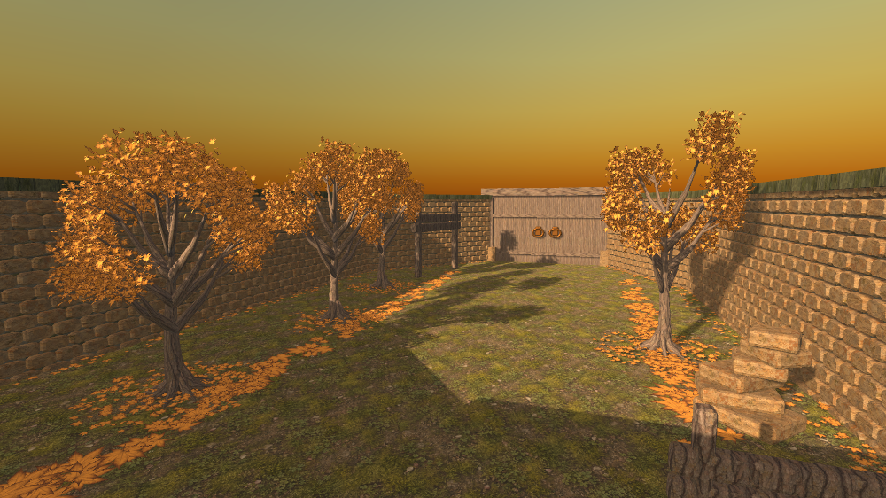

# 가을맵 시각 품질 개선

## 적용 범위

- 실제 게임 경로인 `Assets/Scenes/SeasonRooms/AutumnJourney9/Autumn_Room01~09.unity`에 적용.
- 기존 방 윤곽, 나무·구조물의 배치, 문, 상점방·합성방 위치와 가을 색 변화 유지.
- 여름의 방당 약 46만~71만 삼각형을 기준으로, 가을은 약 50만~67만 삼각형으로 조정.

## 변경한 표현

1. **단풍나무 3종**: 기존 위치·크기를 유지하면서 세갈래 잔가지, 줄기의 수피 굴곡, 입체 잎과 촘촘한 수관을 추가. 각 나무에 근거리/원거리 메시를 별도로 연결.
2. **돌담**: 평평한 표면 앞에 모서리가 닳고 조금씩 다른 형태를 가진 돌을 배치한 메시 추가. 기존 벽의 시각 메시만 안쪽으로 줄여 줄눈 바탕으로 사용. 벽 콜라이더는 원본 유지.
3. **낙엽**: 벽 밑과 기존 나무 밑에 굽은 잎을 추가. 기존 방별 단풍 재질을 사용. 실제 바닥 메시 바깥의 잎은 잘라 공중에 떠 보이는 외곽 장식을 제거.
4. **거리별 표시**: 돌담·낙엽에 LOD 2단계, 나무에 기존 LOD 연결을 유지하며 새 메시를 적용.

## 최종 삼각형 수

닫힌 문, 바닥, 벽, 구조물, 나무, 낙엽을 포함한 방 전체 기준. 플레이어·몬스터 제외. 5번의 상점방과 7번의 합성방 포함.
근거리는 모든 LOD0, 원거리는 각 LODGroup의 마지막 비어 있지 않은 단계만 합산했다. 실제 화면의 수치 및 그림자 렌더링 횟수와는 다르다.

| 방 | 근거리 | 원거리 | 콜라이더 수 |
|---|---:|---:|---:|
| 1 | 527,622 | 198,050 | 21 |
| 2 | 537,360 | 202,259 | 26 |
| 3 | 503,534 | 186,876 | 29 |
| 4 | 569,232 | 218,490 | 36 |
| 5 (상점) | 514,673 | 221,588 | 43 |
| 6 | 554,730 | 212,282 | 31 |
| 7 (합성) | 671,821 | 267,319 | 45 |
| 8 | 574,231 | 220,738 | 30 |
| 9 | 580,248 | 224,901 | 40 |

## 확인 결과

- 9개 방의 콜라이더 컴포넌트 직렬화 데이터가 작업 전 백업과 일치.
- 모든 콜라이더의 월드 위치와 크기도 작업 전과 일치.
- 문·Encounter·NavMesh 참조 정상, 누락된 프리팹/재질 0개.
- 새 장식은 기존 streamedGeometry 하위에 배치. 원래처럼 비활성 상태로 저장하고 게임에서 방 로딩 시 활성화.
- 플레이 모드에서 첫 방 GeometryReady=true, 새 장식 그룹 1개 및 나무 메시 활성화, 몬스터 3마리 소환 확인.
- 1번 전체/근접, 3번 좁은 통로, 7번 합성방을 이미지로 확인.
- 플레이 확인 후 정지하고 Stage3_Fall을 열어 둠. 배경 실행 설정 원복.
- FPS 벤치마크나 9개 방 전체 전투 완주 테스트는 하지 않음.
- 플레이 화면을 도구로 캡처하는 과정에서 MCP ScreenshotUtility의 PlayerLoop 재진입 로그 1회 확인. 캡처 전 게임 로딩 확인 시 오류 0개였으며, 스택은 MCP 캡처 도구 내부였다.

## 원본 및 에셋

- Blender 제작 소스: `ArtSource/AutumnPolish/build_autumn_polish.py`, `AutumnPolish.blend`
- 배치 참조 스냅샷: `ArtSource/AutumnPolish/room_layout.json`
- 외곽 낙엽 정리 단계: `ArtSource/AutumnPolish/trim_leaf_meshes.cs.txt` (Unity Editor의 메시 에셋 생성용, 씬 오브젝트 생성 없음)
- 모델: `Assets/Art/AutumnPolish/Models`
- Inspector에 연결한 나무·줄눈·낙엽 메시: `Assets/Art/AutumnPolish/Meshes`
- 기존 텍스처와 방별 단풍 재질 재사용: `Assets/Art/AutumnCrafted`
- 씬 오브젝트 생성과 MeshFilter/재질 연결은 Unity MCP의 Hierarchy/Inspector 도구로 직접 수행.
- 작업 전 씬 백업: `Temp/AutumnPolish/Backup` (임시 로컬 백업)

