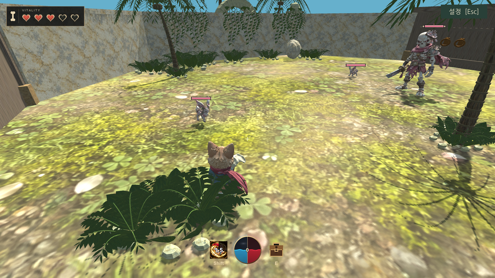

# 여름 맵 디자인 개선 — 2026-09-22

## 변경 내용

봄 맵의 풍성한 식생과 장식 밀도를 참고하여 여름 7개 방의 배경을 보완했다. 봄의 폴리곤 수를 그대로 맞추는 대신 해안·열대 식물·석조 유적을 사용했다.

- Blender에서 야자수, 열대 식물 군락, 식물이 자란 석회암 바위, 석조 아치, 유적 기둥, 벽 덩굴 등 6종을 제작했다.
- 각 모델에 가까운 거리/먼 거리 메시 2단계와 LODGroup을 적용했다. 잎이 사라지지 않도록 원거리 모델도 잎의 형태를 유지하고 곡면 분할을 줄였다.
- 기존 계절 아틀라스 텍스처와 양면 재질을 재사용하여 잎 뒷면도 표시한다.
- 기존 야자수의 렌더러를 끄고 같은 위치에 새 야자수를 배치했다. 기존 충돌체는 유지한다.
- 바닥의 낮은 식물, 벽 덩굴, 벽 뒤 야자수, 해안 바위, 유적 실루엣을 층별로 배치했다.
- 2번 상점 주변과 6번 합성방 주변을 추가로 장식했다. 7번은 큰 아치와 양옆 아치로 마지막 방의 배경을 강조했다.
- 중앙 전투 공간과 문 통로를 확보했다. 새 바위·기둥·아치는 주로 기존 벽 밖 배경이고, 바닥 식물은 통과 가능한 장식이다. 새 충돌체는 추가하지 않았다.
- Unity Hierarchy에서 직접 프리팹을 배치하고 저장했다. 실행 중에 새 장식을 만드는 코드는 추가하지 않았다.

## 방별 삼각형 수

배경·구조물 기준. 상점/합성방은 소속 방에 포함한다. 플레이어, 실행 중 생성되는 몬스터, 이펙트는 제외한다. 각 방의 모든 배경이 활성화되었을 때의 합계이며, 실제 프레임에 그려지는 수는 카메라와 가림 상태에 따라 다르다.

| 방 | 변경 전 | 변경 후 가까운 모델 | 변경 후 먼 모델 | 새 장식/LODGroup |
|---|---:|---:|---:|---:|
| 1 | 11,004 | 245,108 | 136,932 | 27 |
| 2 · 상점 | 17,404 | 226,926 | 126,477 | 23 |
| 3 | 13,704 | 236,112 | 129,653 | 26 |
| 4 | 16,296 | 238,704 | 132,245 | 26 |
| 5 | 18,024 | 251,512 | 138,051 | 27 |
| 6 · 합성방 | 23,044 | 264,396 | 148,802 | 28 |
| 7 | 21,620 | 281,408 | 154,981 | 30 |

## 수정 위치

- 방 씬: `Assets/Scenes/SeasonRooms/SummerJourney7/Summer_Room01~07.unity`
- 새 오브젝트: 각 방의 `Summer_Coastal_Decor/Summer_Detail_*`
- 재사용 프리팹: `Assets/Art/SummerPolish/Prefabs/`
- FBX: `Assets/Art/SummerPolish/Models/`
- 재질: `Assets/Art/SummerPolish/SummerPolish_Surface.mat`
- Blender 원본: `ArtSource/SummerPolish/SummerPolish.blend`
- 모델 제작 기록: `ArtSource/SummerPolish/build_summer_details.py`

기존 스트리밍 방식에 따라 배경 그룹은 저장 시 비활성화되며 플레이할 때 활성화된다. 편집 상태에서 보려면 해당 방의 배경 그룹을 켜면 된다.

## 확인 결과와 범위

- 7개 방 모두 저장된 메시·재질·스크립트 누락 없음.
- 이전 야자수 렌더러가 비활성화된 것을 저장된 씬에서 확인.
- 저장된 NavMesh의 7개 방 중앙 경로, 2번 상점 경로, 6번 합성방 경로 연결 확인. 충돌체 변경이 없어 NavMesh는 재베이크하지 않았다.
- 7개 방을 편집 화면에서 개별 시점으로 확인.
- 플레이 모드에서 1번 방 스트리밍, 새 장식 27개 활성화, 몬스터 생성 및 화면 표시 확인. 해당 실행 중 콘솔 오류 0건.
- 모든 방을 실제 조작하여 통과하는 테스트와 FPS/메모리 성능 측정은 진행하지 않았다.
- 가을·봄 맵과 게임플레이 스크립트는 이번 작업에서 변경하지 않았다. 커밋·푸시는 하지 않았다.

