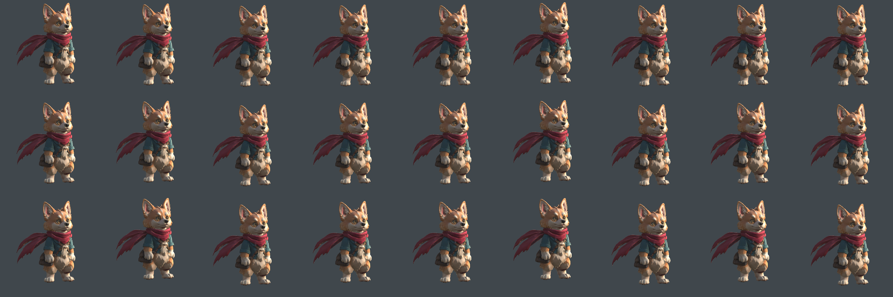
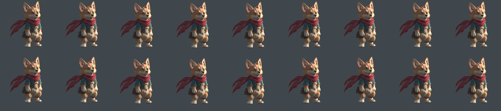

# 플레이어 9방향 이동 애니메이션

## 걷는 중 주기적으로 멈추는 현상 수정

- 5.87~7.57초 원본 동작 전체를 반복하면서 시작/종료의 저속 구간도 재생되는 문제를 확인했습니다.
- 적용용 8개 클립에서 안정된 보행 주기 0.97~1.50초를 추출했습니다. 반복 경계에서 곡선 값과 탄젠트가 같도록 보정했습니다. 원본은 보존했습니다.
- 생성 코드에도 동일 처리를 연결했습니다. 기존 속도 기반 Idle 전환은 유지하여 실제로 멈추거나 벽에 막히면 대기 자세가 됩니다.
- 격리한 실제 Animator 컨트롤러에서 방향별 20초를 30fps로 평가했습니다. 정지 프레임 0, 반복 경계 곡선/탄젠트 차이 0을 확인했습니다. 이는 전체 게임을 직접 조작한 검증은 아닙니다.
- 추출 구간 및 검사 결과: `WalkLoopVerification.txt`. 수정 포즈: `WalkLoopPoses.png`. 아래 과거 검증 이미지는 이번 주기 추출 이전 기록입니다.

- `DogLight.controller`의 Base Layer → `Locomotion` → `Locomotion_9Directions`에 **2D Simple Directional Blend Tree**를 적용했습니다.
- 중심은 기존 `DogLight_Idle`, 나머지는 앞/뒤/좌/우 및 네 대각선입니다. 기존 Scarf Wind 레이어는 유지했습니다.
- Generic 리그에 맞춰 Right 클립의 Left/Right 뼈 경로를 교환하고, 위치 X와 회전 Quaternion Y/Z 곡선 및 탄젠트를 반사한 `Walk_Left`를 만들었습니다. 음수 모델 스케일이나 역재생 방식은 사용하지 않습니다.
- 플레이어의 skel 스케일이 100이므로 이동 클립의 위치 곡선을 0.01배로 변환했습니다. 원본 VARCO 클립은 수정하지 않고 `Assets/Art/Player3D/DogLight/Animations/Locomotion/`에 적용용 클립을 저장했습니다. 걷기 반복 재생을 켰습니다.
- `PlayerDirectionalAnimation`이 Rigidbody의 실제 수평 속도를 몸이 바라보는 방향 기준으로 변환해 MoveX/MoveY를 갱신합니다. 0.1초 감쇠로 전환하며 대각선 속도는 정규화합니다. Root Motion은 사용하지 않습니다.
- 방향별 이동을 사용하는 플레이어는 이동 방향으로 몸을 강제 회전하지 않고 기존 무기 조준 방향을 유지합니다. 따라서 좌우 이동과 후진에 옆걸음/뒷걸음이 선택됩니다. 실제로 정지하면 Idle입니다.
- 공용 `Assets/Prefabs/Player.prefab`과 현재 `Stage1_Spring`의 플레이어에 연결했습니다. 점프·대시·전투 로직과 스카프 레이어는 유지합니다. 별도 점프/공격 애니메이션 추가는 이번 범위에 포함하지 않습니다.

## 확인

- Blend Tree 9개 좌표에서 기대 클립 가중치 1, 뼈 경로 누락 0 (`BlendTreeVerification.json`).
- 미러 클립 5개 시점의 좌우 반사 위치/회전 오차 0.
- 플레이 모드에서 수평 속도 9종을 주입하여 MoveX/MoveY와 선택 클립이 모두 기대값과 일치함을 확인 (`RuntimeParameters.json`). 전체 전투 플레이 검증은 아닙니다.
- 초기 확인에서는 단위만 보정해 뼈 좌표 기준 차이를 놓쳤습니다. 아래 추가 수정으로 대기/걷기 간 좌표 기준을 통일했습니다.

## 몸 뒤틀림 수정

- 원본 USD 클립과 플레이어 FBX 리그는 뼈 좌표 기준이 다릅니다. 위치를 0.01배로 축소하는 것 외에 위치 X/Z와 회전 Quaternion X/Z의 부호를 변환해야 합니다. 이 변환이 누락되어 걷기로 전환할 때 몸이 꺾였습니다.
- 원본에서 이동 클립 8개를 다시 변환했습니다. 왼쪽은 오른쪽 뼈 경로 교환 및 반사 후 동일한 좌표 변환을 적용했습니다. 키 값과 탄젠트를 함께 변환하고 Quaternion 연속성을 정리했습니다. 기존 클립 GUID와 연결은 유지했습니다.
- 생성 코드에도 좌표 변환을 반영했습니다. 원본 VARCO 클립은 변경하지 않았습니다.
- 9개 클립을 각각 1.5/3.0/4.5초에서 렌더링했고, 실제 컨트롤러에서 각 방향 50% 대기 혼합 및 100% 걷기를 렌더링했습니다. 확인한 포즈에서는 몸 뒤틀림이 보이지 않았고, 컴파일/콘솔 오류는 0건입니다. 전체 플레이 구간을 직접 조작해 검증한 것은 아닙니다.
- `CorrectedPoses.png`: 열은 아래 순서, 행은 1.5/3.0/4.5초.
- `CorrectedBlends.png`: 같은 열 순서, 위는 50% 혼합, 아래는 100% 방향 입력. 가중치는 `CorrectedBlends.txt`에 기록했습니다.

미리보기 순서: Idle / Front / Back / Right / Left / RightFront / RightBack / LeftFront / LeftBack.

